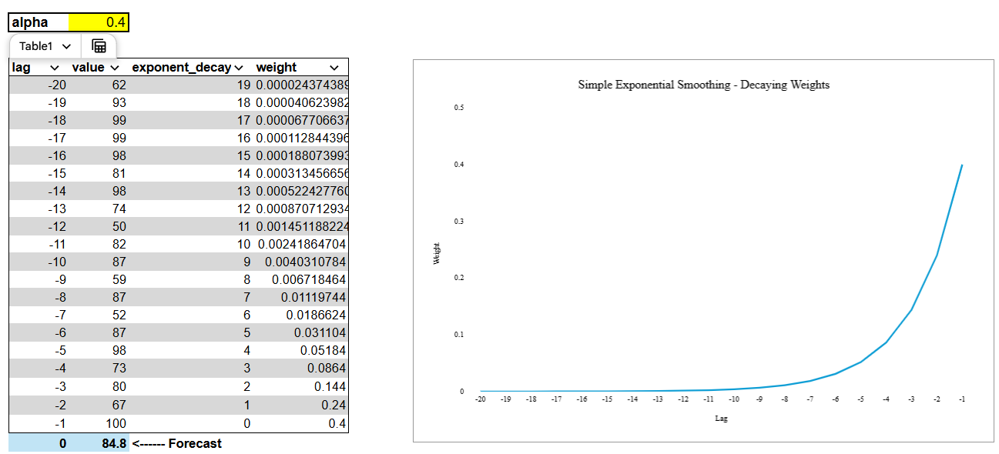
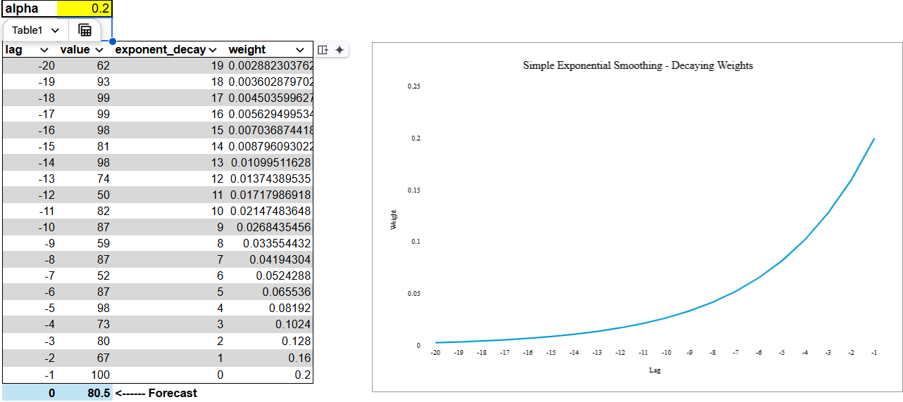

One of the most popular time series forecasting methods is Exponential Smoothing. This article defines Simple Exponential Smoothing, describes how it works at a basic level, and walks through an implementation of it in Python using the statsmodels package.

## Defining Simple Exponential Smoothing

The idea behind Exponential Smoothing is simple. As Hyndman and Athanasopoulos define it in [*Forecasting: Principles and Practice*](https://otexts.com/fpp3/ses.html), "Forecasts produced using exponential smoothing methods are weighted averages of past observations, with the weights decaying exponentially as the observations get older. In other words, the more recent the observation the higher the associated weight."

Unlike [ARIMA models](../intro-to-arima/index.html), which use past values or past errors at specific lags, Exponential Smoothing uses all previous values that you train the model on.

Exponential Smoothing methods include:

- Simple Exponential Smoothing (SES)
- Exponential Smoothing with Trend (Holt)
- Exponential Smoothing with Seasonality and Trend (Holt-Winters)

This article focuses on the first of these versions of Exponential Smoothing. In future articles, we will explore Exponential Smoothing with Trend and with Seasonality and Trend.

## How Exponential Smoothing Works

Simple Exponential Smoothing uses an alpha ($\alpha$) parameter (between 0 and 1) that determines the weight of the most recent instance in the dataset.

- Low $\alpha$ = less weight on the most recent instance, the weight is more spread out across historical instances
- High $\alpha$ = more weight on the most recent instance, with less weight on instances further in the past

Once that weight has been assigned to the most recent instance, all previous instances receive an exponentially diminishing weight the further you get into the past. Specifically, the weights are $\alpha$, $\alpha(1-\alpha)$, $\alpha(1-\alpha)^2$, $\alpha(1-\alpha)^3$, and so on.

To experiment with how this works, check out [this Excel file](../intro-to-exponential-smoothing/exponential_smoothing_decaying_weights_example.xlsx). This file allows you to see how changing the alpha value affects the distribution of weight and the resulting forecast.

Here is what Exponential Smoothing on a toy dataset looks like with an alpha level of 0.40. Notice the steepness of the line chart to the right. This is indicative of the heavier weight at lag 1 and more rapidly decreasing weights on lags 2 and prior.



Now, let's compare what Exponential Smoothing on the same dataset looks like with an alpha level of 0.20. The line this time is less steep. This reflects less weight at lag 1 and more gradually decreasing weights on lags 2 and prior.



The forecast, for Exponential Smoothing models, just becomes the sum of the weighted past values. Let's now walk through how to easily set up a model like this in Python.

## Setting up Exponential Smoothing Models in Python - A Mini Case Study

Imagine that you work for a company that develops residential housing in rural Midwest communities. Your company is considering a housing project in either Warren County, Indiana or Benton County, Indiana. They have tasked you to see which county is likely to have more population growth over the next two-year period, and you believe that Exponential Smoothing may be an effective way to predict this.

### Loading Packages and Preparing Dataset

We will first load the needed Python packages. Then we will bring in the raw annual population numbers for these two counties from 2000 to 2025.


```{python}

#Necessary imports
import numpy as np
import pandas as pd
import matplotlib.pyplot as plt
from statsmodels.tsa.holtwinters import ExponentialSmoothing

#Load data
data = pd.read_csv('county_population.csv')

#Convert year column to index
data = data.set_index('year')

#Divide 2 counties' data into separate series
benton_co = data.loc[data['county']=='Benton','population'].sort_index()
warren_co = data.loc[data['county']=='Warren', 'population'].sort_index()

#Check first 5 rows of each series
print('Benton County Population: ', benton_co.head())
print('Warren County Population: ', warren_co.head())
```

Now that our data is loaded, we need to convert the raw population numbers to the *change* in population year over year.

```{python}

#Get change between instances using `.diff()` function, dropping the resulting null values using `dropna()`
benton_co = benton_co.diff(1).dropna()
warren_co = warren_co.diff(1).dropna()
```

### Visualize the Data

Now let's plot each series to visually analyze the population changes over time for each county. Keep in mind that negative values indicate years of population decline, while positive values indicate years of population increase.

```{python}
benton_co.plot(figsize=(8,6), label='Benton')
warren_co.plot(label='Warren')
plt.axhline(y=0, c='red', linestyle='--')
plt.legend()
plt.title('Annual Change in Population: Benton and Warren County, Indiana 2001-2025')
plt.ylabel('Change in Population')
plt.xlabel('Year')
plt.show()
```

Looking at this line plot reveals a few things:

- Both counties have a mix of positive and negative years.
- Benton County shows a slight upward trend from 2001 to 2025, while Warren County is more flat overall across the entire dataset.
- Within the past few years, Benton County has shown more growth than Warren County.
- Both counties saw little population change in 2025, the final year of our dataset.

### Building the Models

In a real-world project, you would do much more exploration and research at this step. You could consider economic, demographic, and social factors that could shed light on future population trends. For the purpose of this example though, we will proceed with building Exponential Smoothing models for each of these datasets and projecting population change over the next two-year period.

To do this, we will use statsmodels' `ExponentialSmoothing()` function. It is fairly simple to use, but it is helpful to familiarize yourself with the main parameters. If you do not set trend, seasonal, or seasonal_periods, the default settings are None. Your model will not pick up on these data structures automatically. This is fine in our case, since we are wanting to create a Simple Exponential Smoothing model, but it is important to know about these parameters. The following are particularly important:

- `trend=None` — options: `"add"`, `"mul"`, `"additive"`, `"multiplicative"`
- `damped_trend=False` — boolean
- `seasonal=None` — options: `"add"`, `"mul"`, `"additive"`, `"multiplicative"`
- `seasonal_periods=None` — integer

::: {.callout-tip}
If the optimizer is giving you strange outputs, it might be initializing values that lead to a sub-optimal result. You can use the `initialization_method` parameter to control how the starting values are set. We set it to `'estimated'` below, which estimates the initial values along with alpha.
:::

See the [statsmodels `ExponentialSmoothing` documentation](https://www.statsmodels.org/stable/generated/statsmodels.tsa.holtwinters.ExponentialSmoothing.html) for more information.

```{python}
#| warning: false
#| output: false

exp_smooth_benton = ExponentialSmoothing(
                benton_co, #Here's where you put your training data
                initialization_method='estimated'
                ).fit(optimized=True) #Note, you need to fit the model. You can often do this in one step with the model creation.

exp_smooth_warren = ExponentialSmoothing(
                warren_co, #Here's where you put your training data
                initialization_method='estimated'
                ).fit(optimized=True) #Note, you need to fit the model. You can often do this in one step with the model creation.

#With optimized=True (default), the `.fit()` method will automatically try to find the best alpha for you (minimizing SSE)
```

We have now created Exponential Smoothing models for each of the counties we are analyzing. Let's check the alpha level for each of these models.

```{python}
print('Alpha Level - Benton County Model: ', np.round(exp_smooth_benton.params['smoothing_level'], 4))
print('Alpha Level - Warren County Model: ', np.round(exp_smooth_warren.params['smoothing_level'], 4))
```

Our optimization found the optimal alpha level for the Benton County model as approximately `{python} round(float(exp_smooth_benton.params['smoothing_level']), 4)` and the optimal alpha level for the Warren County model as approximately `{python} round(float(exp_smooth_warren.params['smoothing_level']), 4)`. This means that the Benton County model assigns a weight of `{python} round(float(exp_smooth_benton.params['smoothing_level']), 4)` to the most recent instance, while the Warren County model assigns a weight of `{python} round(float(exp_smooth_warren.params['smoothing_level']), 4)` to the most recent instance.

### Analyze Results

Let's take a look at our fitted values for each model. Fitted values are the model's one-step-ahead predictions within the training data.


```{python}
#Retrieve fitted values
fitted_vals_benton = exp_smooth_benton.fittedvalues

fitted_vals_benton.plot(figsize=(8, 6), label='Fitted Values')
benton_co.plot(label='Actuals')
plt.title('Benton County, Indiana Yearly Population Change: Actuals vs Fitted Values')
plt.ylabel('Population Change')
plt.xlabel('Year')
plt.legend()
plt.show()
```

```{python}
#Retrieve fitted values
fitted_vals_warren = exp_smooth_warren.fittedvalues

fitted_vals_warren.plot(figsize=(8, 6), label='Fitted Values')
warren_co.plot(label='Actuals')
plt.title('Warren County, Indiana Yearly Population Change: Actuals vs Fitted Values')
plt.ylabel('Population Change')
plt.xlabel('Year')
plt.legend()
plt.show()
```

Both of our Exponential Smoothing models do a fair job of tracking the population change for these counties. The upward direction of Benton County's population is apparent, while the more inconsistent nature of Warren County's population is also visible.

Let's now use the `.forecast()` method to generate two years of projections for both counties.

::: {.callout-note}
Because our models have no trend or seasonality, every future forecast takes the same value. In other words, future forecasts become a "flat line."
:::

```{python}
#| output: false

benton_county_forecast = exp_smooth_benton.forecast(steps=2)
warren_county_forecast = exp_smooth_warren.forecast(steps=2)

```

```{python}
print(benton_county_forecast)
print(warren_county_forecast)
```

Our models project that Benton County will grow by about `{python} round(float(benton_county_forecast.iloc[0]), 1)` people each year for the next two years, while Warren County will grow by only about `{python} round(float(warren_county_forecast.iloc[0]), 1)` people each year over the same period.

You share this data with your company, and they decide to plan to build a few new houses in Benton County, while continuing to monitor trends in Warren County before making any decisions to build houses there.

## Conclusion

In a real-world project, you would likely test a variety of different models using rolling-horizon cross-validation, a topic which will be covered in a future article. However, in this article, we walked through the basics of how Simple Exponential Smoothing models work, as well as a simple coding example in Python.

Take some time to walk through these steps yourself with a time series dataset that interests you. Next time, we will look at how Exponential Smoothing models can be made even more powerful and versatile by introducing trend and seasonality into the model.
