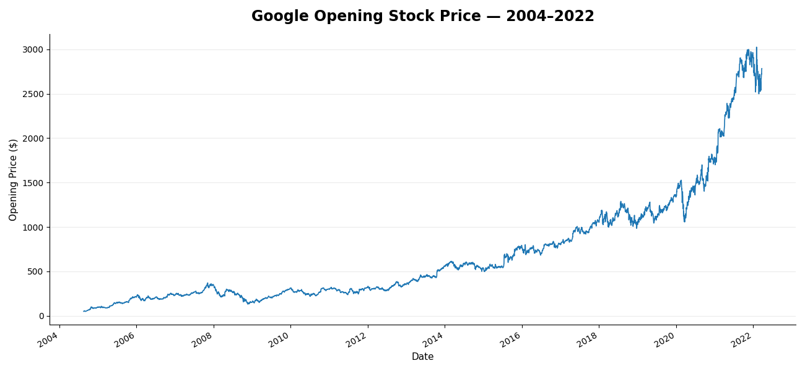
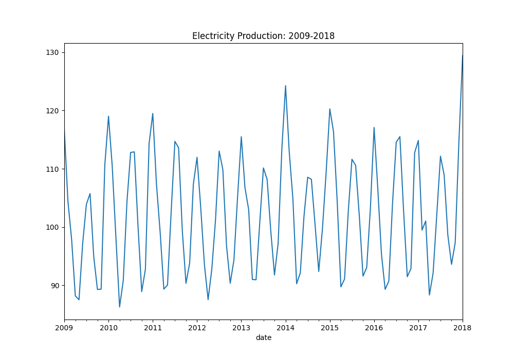
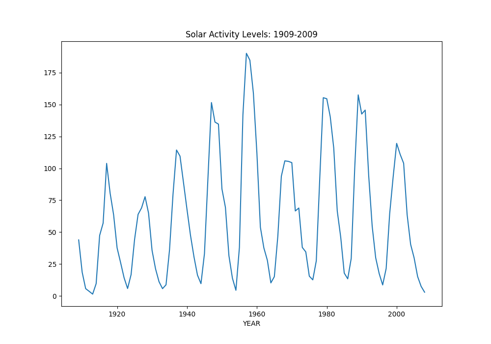

This articles explores the main structural elements to look for when exploring a time series data set and gives a basic example of time series decomposition.

## Time Series Structures

There are four main structures to look for when you are exploring a time series data set. Understanding these structural elements is an important part of learning about your time series, determining which preprocessing steps are needed, and deciding which models would be most appropriate for forecasting.

### Trend

A trend is a long-term increase or decrease in the data. It describes an overall direction of the data set, whether upward or downward. 

The following line plot of the daily Google opening stock price from 2004 to 2022 illustrates a clear example of an upward trend. If, on the other hand, the overall direction of the data appeared to be "flat", this would likely indicate the absence of a trend.



### Seasonality
Seasonality describes repeating fluctuations that occur at consistent intervals. These could show up as "peaks" or "valleys" in your time series data. For example, if you are a marketing analyst for a large online toy retailer, you might see regular, recurring spikes in sales in Q4 of each year around the holidays. This is a form of seasonality. Depending on the granularity of your data set, it could occur at other frequencies such as on certain days of the week or during certain hours of the day. The key is that it is of a consistent and repeating pattern.

The following plot of monthly electricity production from 2009-2018 shows clear seasonal structure. This seasonality aligns with what we intuitively would expect about electricity use. The highest electricity production is in the winter and, to a lesser extent, in the summer. Spring and fall show relatively lower levels of production. This pattern is repeating and at consistent intervals. If, on the other hand, the fluctuations in the data appeared to be random, with no clear pattern, we would not consider them to be seasonal in nature.



### Cycles
Cycles describe longer term rises and falls in a data set that do repeat but not at a consistent interval. These are very commonly discussed in the field of economics and finance. Unlike seasonality, cycles are often difficult to predict.

The following plot of solar activity from 1909-2009 shows a clear cyclical pattern in the data. The increases and decreases in solar activity are longer in nature than seasonal fluctuations and are more difficult to anticipate.



### Noise
Whatever is left over after accounting for the time series structures described so far is the noise in the data set. Noise consists of random fluctuations in the data that cannot be attributed to any perceivable structure. A time series data set that has no perceivable structure is called "white noise". In the real world, virtually all time series data will have some amount of noise in it. 

## Time Series Decomposition
Time series decomposition is the process of taking a time series data set and splitting it apart into its different structures. Using the `flights` data set from the seaborn package in Python, let's walk through a simple example of time series decomposition. To accomplish this, we'll rely on statsmodels' `seasonal_decompose` function.

Note, the model parameter is very important. If seasonality remains at a consistent level, you can use "additive". If the seasonal fluctuations become more extreme as the time series increases, you will want to use "multiplicative". We will explore this further in another article. For more information check out the statsmodels documentation here: https://www.statsmodels.org/stable/generated/statsmodels.tsa.seasonal.seasonal_decompose.html

For more complex time series or time series with extreme outliers, you should consider using STL decomposition. More information is available here: https://www.statsmodels.org/devel/generated/statsmodels.tsa.seasonal.STL.html


```{python}
#Necessary imports
import pandas as pd
import matplotlib.pyplot as plt
import seaborn as sns
from statsmodels.tsa.seasonal import seasonal_decompose

#Load flights data into 'flights' dataframe
flights = sns.load_dataset("flights")

#You will often need to convert your data into a more usable form, usually with some type of time index.
#This code converts the 'year' and 'month' columns into a single datatime column then sets that column as our index.

flights['date'] = pd.to_datetime(
    flights['year'].astype(str) + '-' + flights['month'].astype(str), format='%Y-%b'
)

flights = flights.set_index('date')

#Separate the target feature into a series. We no longer need the month/year columns since our index  already has that information.
y = flights['passengers']

#Use the seasonal_decompose function to decompose your time series, be sure to choose the correct model parameter
flights_decomp = seasonal_decompose(
                    y,
                    #model='additive',
                    model='multiplicative'
                )
fig = flights_decomp.plot()
fig.set_size_inches(10, 7);
```

The resulting plots give us the decomposed version of the time series. This can be extremely helpful in understanding the structure of our data.

The first line graph is the original data set without any decomposition.

The second reveals the trend in the data.

The third reveals the seasonality in the data.

The final plot reveals the residuals (or noise) in the data set. For additive, this should cluster around 0. For multiplicative, this should cluster around 1. You hope to not see remaining structure or changing variance in the residuals.

In the case of the flights data set, we can clearly see a consistent upward trend. We also see strong seasonal fluctuations, with spikes and valleys occurring at consistent points each year. Finally, we see that the residuals appear to have little to no remaining structure and are tightly clustered around 1.

Often times, your data sets may not decompose this cleanly. However, this is an important exercise that is very helpful in learning about the underlying time series structures.

## Conclusion

To sum up, the four main structures you are looking for within your time series are trend, seasonal fluctuations, cycles, and noise. Time series decomposition can be a useful tool in exploring these aspects of your time series.