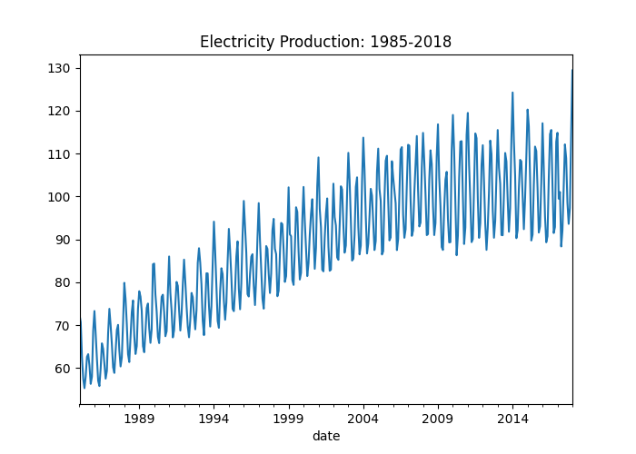
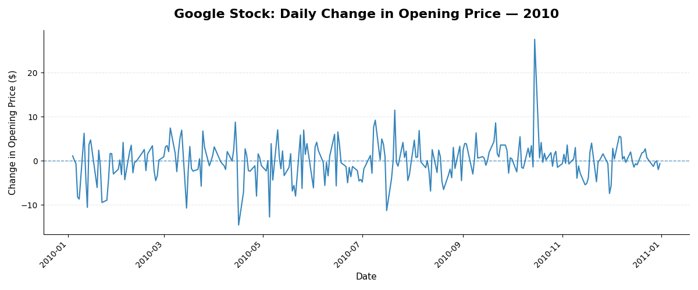

Stationarity is an important concept within time series analysis. Some types of statistical time series models such as ARIMA require a time series to be stationary.

## Defining Stationarity

In simple terms, stationarity describes how stable a time series is, specifically with regards to the mean and variance of the time series.

A stationary time series is one with a relatively stable mean and variance. This does not mean the time series is completely flat, with no fluctuations; it just means that, over the course of time, the mean and variance of the data are relatively stable. A non-stationary time series is one which has a mean or variance that are not consistent over time.

## Determining whether a Time Series is Stationary

There are two main ways to identify whether a time series is stationary or non-stationary: visualization and statistical tests. We will explore each of these briefly.

### Visualization

If a time series has a trend or seasonality, it is non-stationary. Understanding the structure of your time series, then, can be a quick way to determine whether or not your time series is stationary. The easiest way to do this is by visualizing your time series. Often a simple line plot can reveal trend or seasonality, or you can decompose your time series. See [this article](../time-series-structures/index.html) for more information about time series structures and decomposition.

Let's first take a look at an example of a non-stationary time series.



This line graph displays the monthly electricity production from 1985-2018. Just a cursory glance indicates that neither the mean nor the variance are consistent over time. There is a clear upward trend to the data as well as increasing seasonal variance as well. This gives us strong evidence that we are dealing with a non-stationary data set.

Now, let's see an example of a stationary time series.



This line graph displays the daily change in the opening stock price for Google's stock in 2010. What we see here is that, while there are certainly day-to-day fluctuations, the overall mean and variance appear to be relatively stable. There does not appear to be a trend to the data or consistent seasonal fluctuations. 

### Statistical Tests

At times, the visual evidence may be unclear, particularly if you have a noisy data set. In this case, you should use a statistical test to check whether your time series is stationary or non-stationary. There are different statistical tests available, but the most common is called the Augmented Dickey-Fuller test. 

This test checks the time series for the presence of something called a "unit root". If there is a unit root present, it indicates a non-stationary time series. The test operates with the following hypotheses:

Null Hypothesis: Has Unit Root: Time Series is Non-Stationary
Alternate Hypothesis: Does not Have Unit Root: Time Series is Stationary

A p-value of below .05 is typically interpreted as strong evidence to reject the null hypothesis (i.e., your time series is stationary), while a p-value of above .05 is interpreted as insufficient evidence to reject the null hypothesis (i.e., your time series is nonstationary). Note, this test, though helpful, is not a 100% guarantee. It should always be paired with visual exploration prior to model creation and additional testing of the model's performance.

The statsmodels `adfuller` function performs this test for us. Let's run our electricity production data from earlier in the article through the adfuller test as an example.

```{python}
import pandas as pd
from statsmodels.tsa.stattools import adfuller

elec_production = pd.read_csv('Electric_Production.csv')
elec_production['DATE'] = pd.to_datetime(elec_production['DATE'])
elec_production = elec_production.rename(columns={'DATE': 'date', 'IPG2211A2N': 'electricity_production'})
elec_production = elec_production.set_index('date')
elec_production = elec_production.asfreq('MS')

elec_adf_result = adfuller(elec_production)
print('adf p-value:', elec_adf_result[1])
```

The p-value in our adfuller results is greater than the critical value of .05. This gives us additional evidence that we are dealing with a non-stationary time series, confirming what we observed from the visualization. If our p-value was below .05, that would typically be interpretted as evidence that of stationarity in our data.

In future articles, we will explore this idea of stationarity further. We will consider additional examples and look at how we can make a non-stationary time series stationary by *differencing* the data set.